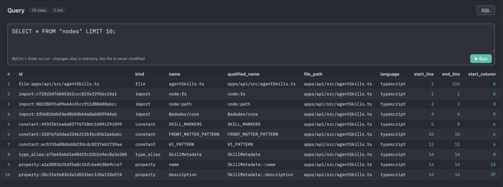
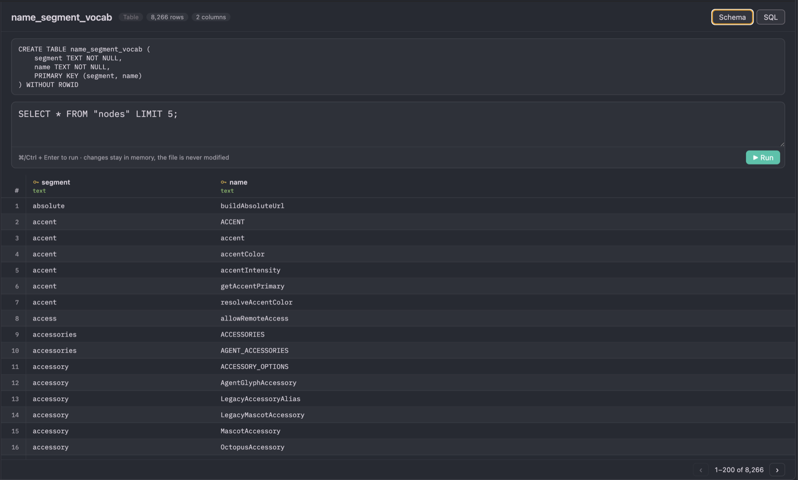

# SQLite Peek

A free, read-only SQLite viewer for VS Code. Open any `.db`, `.sqlite`, `.sqlite3`, `.db3`, `.s3db` or `.sl3` file and it opens in a table browser.

- Browse tables and views with row counts, column types and primary keys
- Page through rows 200 at a time
- Run SQL queries (⌘/Ctrl + Enter). Changes stay in memory; the file is never modified
- Reloads automatically when the file changes on disk
- Follows your VS Code theme






Powered by [sql.js](https://github.com/sql-js/sql.js) (SQLite compiled to WebAssembly). No native build step.

## Install

Install **SQLite Peek** from the VS Code Marketplace, or from the command line:

```sh
code --install-extension christopheralphonse.sqlite-peek
```

Or install a release build directly:

```sh
curl -fsSL -o /tmp/sqlite-peek.vsix \
  https://github.com/ChristopherAlphonse/sqlite-viewer-local/releases/latest/download/sqlite-peek.vsix \
  && code --install-extension /tmp/sqlite-peek.vsix --force
```

## Limitations

- The whole file is loaded into memory, so very large databases (multiple GB) may fail to open.
- Only the main database file is read. Writes still sitting in a `-wal` file show up once SQLite checkpoints them into the main file.

## Develop

```sh
npm install
npm run package                     # builds sqlite-peek.vsix
code --install-extension sqlite-peek.vsix --force
```

Files: `extension.js` opens the database and runs queries; `media/viewer.js` and `media/viewer.css` are the UI.

## Release

Publishing runs in GitHub Actions ([.github/workflows/publish.yml](.github/workflows/publish.yml)) when a `v*` tag is pushed. It signs in with Marketplace Trusted Publishing (GitHub OIDC), so no token is stored. The publisher `christopheralphonse` has a Trusted Publishing policy for owner `ChristopherAlphonse`, repository `sqlite-viewer-local`, workflow `publish.yml`.

Bump `version` in `package.json`, add a `CHANGELOG.md` entry, commit, then:

```sh
git tag "v$(node -p 'require("./package.json").version')"
git push origin main --tags
```

The workflow publishes to the Marketplace and creates a GitHub release with `sqlite-peek.vsix` attached.
