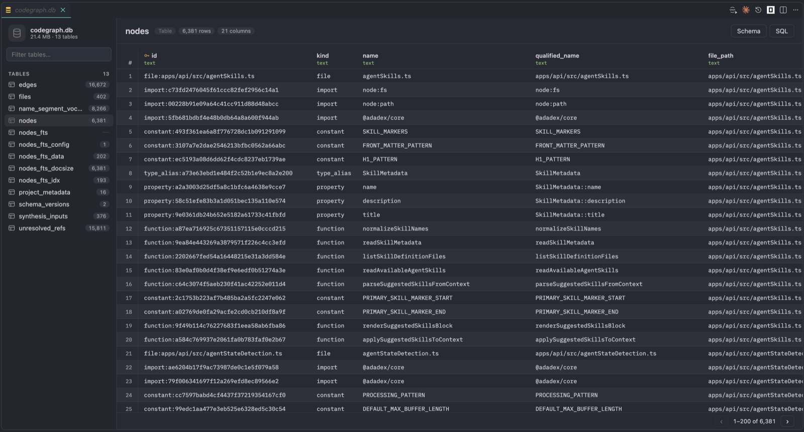

# SQLite Peek

A free, read-only SQLite viewer for VS Code. Open any `.db`, `.sqlite`, `.sqlite3`, `.db3`, `.s3db` or `.sl3` file and it opens in a table browser.

- Browse tables and views with row counts, column types and primary keys
- Page through rows 200 at a time
- Run SQL queries (⌘/Ctrl + Enter). Changes stay in memory; the file is never modified
- Reloads automatically when the file changes on disk
- Follows your VS Code theme




Powered by [sql.js](https://github.com/sql-js/sql.js) (SQLite compiled to WebAssembly). No native build step.

## Install

Install **SQLite Peek** from the VS Code Marketplace, or from the command line:

```sh
code --install-extension christopheralphonse.sqlite-peek
```

Or install a release build directly:

```sh
curl -fsSL -o /tmp/sqlite-peek.vsix \
  https://github.com/ChristopherAlphonse/sqlite-viewer-local/releases/latest/download/sqlite-peek.vsix \
  && code --install-extension /tmp/sqlite-peek.vsix --force
```

## Limitations

- The whole file is loaded into memory, so very large databases (multiple GB) may fail to open.
- Only the main database file is read. Writes still sitting in a `-wal` file show up once SQLite checkpoints them into the main file.

## Develop

```sh
npm install
npm run package                     # builds sqlite-peek.vsix
code --install-extension sqlite-peek.vsix --force
```

Files: `extension.js` opens the database and runs queries; `media/viewer.js` and `media/viewer.css` are the UI.

## Release

Releases come from one GitHub Actions workflow ([.github/workflows/publish.yml](.github/workflows/publish.yml)), so you never bump, tag or write the changelog by hand.

```sh
npm run release          # patch: 1.0.1 -> 1.0.2, then watches the run
npm run release:minor    # 1.0.1 -> 1.1.0
npm run release:major    # 1.0.1 -> 2.0.0
```

Or open **Actions → Release → Run workflow** on GitHub and pick the bump.

The workflow:

1. Bumps `version` in `package.json` and `package-lock.json`.
2. Adds a `CHANGELOG.md` entry built from the commit messages since the last tag.
3. Builds `sqlite-peek.vsix`.
4. Commits `Release vX.Y.Z`, tags `vX.Y.Z`, and pushes both to `main`.
5. Publishes to the VS Code Marketplace using Trusted Publishing (GitHub OIDC), so no token is stored.
6. Creates a GitHub release with the VSIX attached.

Write commit messages as you'd want them in the changelog. Don't edit `version` or push `v*` tags yourself. The run fails if the new tag already exists, and only one release can run at a time.

The Marketplace Trusted Publishing policy on publisher `christopheralphonse` allows owner `ChristopherAlphonse`, repository `sqlite-viewer-local`, workflow `publish.yml`. Renaming the workflow file breaks publishing until the policy is updated.
